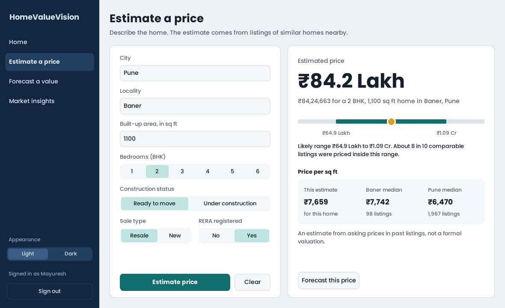
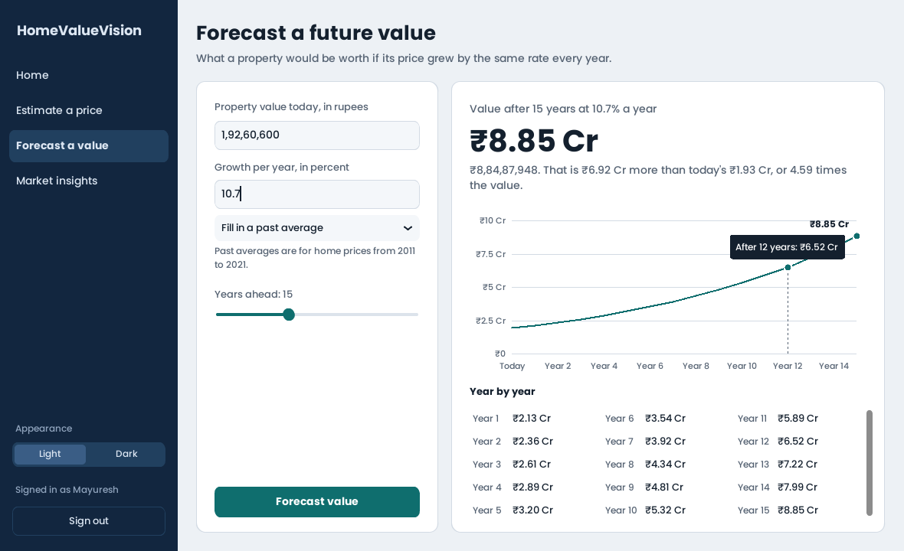
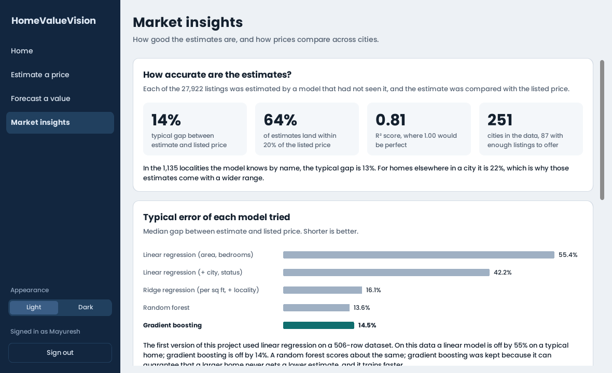
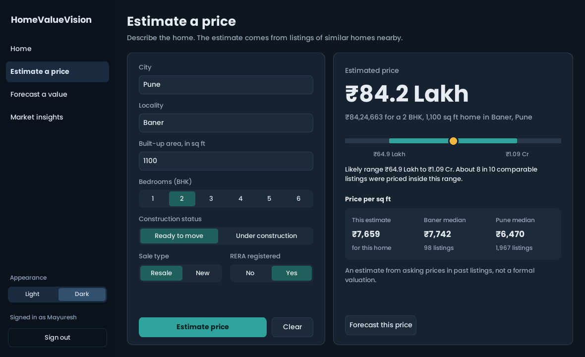

# HomeValueVision

A desktop app that estimates the price of a home in 87 Indian cities, shows the likely
range around that estimate, and forecasts what a property could be worth in future years.
Built with Python, scikit-learn and Tkinter (through CustomTkinter).



| Forecast | Model report | Dark theme |
|---|---|---|
|  |  |  |

## Run it

You need Python 3.10 or newer.

```
pip install -r requirements.txt
python main.py
```

The first time, create an account on the opening screen. Accounts are stored only on your
computer, in `app_data/users.json`, which git ignores.

If your scikit-learn version differs from the one that saved `models/price_model.joblib`,
the app retrains the model from `data/housing_clean.csv` on first launch. That takes a few
seconds and happens once.

## What the app does

- **Estimate a price.** Choose a city and locality (both searchable), enter the built-up
  area, bedrooms, construction status, sale type and RERA registration. You get an
  estimate, a low-to-high range, the price per sq ft, and how that compares with the
  locality and city medians.
- **Forecast a value.** Compound growth at a yearly rate you choose, with a chart and a
  year-by-year table. An estimate can be sent straight to the forecast.
- **Market insights.** How accurate the model is, how it compares with the other models
  that were tried, and median prices per sq ft across the largest cities.

## The model

Every model below was scored with 5-fold cross-validation on the same 27,922 listings, so
each listing is predicted by a model that never saw it.

| Model | R² | Mean error | Typical error (median) | Within 20% of listed price |
|---|---|---|---|---|
| Linear regression (area, bedrooms) | 0.34 | ₹55.3 lakh | 55.4% | 19.6% |
| Linear regression (+ city, status) | 0.56 | ₹42.8 lakh | 42.2% | 26.7% |
| Ridge regression (per sq ft, + locality) | 0.76 | ₹22.7 lakh | 16.1% | 58.7% |
| Random forest | 0.83 | ₹19.5 lakh | 13.6% | 64.9% |
| **Gradient boosting (used in the app)** | **0.81** | **₹20.4 lakh** | **14.5%** | **63.5%** |

How the chosen model works:

1. City and locality are converted to numbers with **target encoding**: each becomes the
   typical price per sq ft there, computed so a listing never sees its own price.
2. Each locality also contributes its latitude and longitude, so nearby localities can
   inform each other.
3. scikit-learn's `HistGradientBoostingRegressor` predicts the log of the price from those
   plus area, bedrooms, construction status, RERA and resale flags.
4. A **monotonic constraint** on area guarantees that, with everything else equal, a larger
   home never gets a lower estimate.

Random forest scores about the same (the gap is within the fold-to-fold variation of
±0.03 in R²). Gradient boosting was kept because random forest cannot give the guarantee
in step 4, and gradient boosting trains about three times faster.

**The range.** The low and high figures are meant to contain 80% of real prices. On 5,585
listings held out from training they contained 82.6%. The range is wider for homes in a
locality the model does not know by name: typical error is 12.5% in the 1,135 named
localities and 21.6% elsewhere.

## The data

`data/raw/india_housing_listings.csv` is the training split of the MachineHack "House Price
Prediction Challenge": 29,451 property listings from across India with area, bedrooms,
address, coordinates, listing flags and price. The first version of this project used the
506-row Boston housing dataset, so this is about 55 times more data, and it is Indian data
priced in rupees.

`python -m ml.prepare_data` cleans it into `data/housing_clean.csv`:

| Step | Rows |
|---|---|
| Raw listings | 29,451 |
| Duplicate listings removed | 1,177 |
| Impossible rows removed (area outside 200 to 10,000 sq ft, price outside ₹1,200 to ₹60,000 per sq ft, more than 8 bedrooms) | 352 |
| **Clean listings** | **27,922** |

It also swaps the latitude and longitude columns back (they are mislabelled in the raw
file), blanks 251 coordinates that fall outside India, and files Mumbai-region localities
that the raw data lists under "Lalitpur" and "Maharashtra" under Mumbai.

Things to know about this data:

- Prices are **asking prices** from one period. They can differ from sale prices and from
  prices today.
- 251 cities appear, but the app offers the 87 that have at least 20 listings. Delhi and
  Hyderabad are not listed as cities; Noida, Gurgaon, Ghaziabad, Faridabad and Secunderabad
  are.
- There is no "age of the property" column, so the old Age input is gone. Construction
  status and resale/new are the closest inputs available.
- The file was taken from a public GitHub copy of the competition data. Its licence terms
  could not be confirmed, so check them before using the data for anything commercial.

## Retrain the model

```
python -m ml.prepare_data     # raw CSV  -> data/housing_clean.csv
python -m ml.train            # compares models, saves models/*.joblib and *.json
```

Training takes about a minute and prints the comparison table shown above.

## Tests

```
pip install pytest
python -m pytest
```

46 tests cover money formatting, the forecast maths, accounts, input checks, the model's
behaviour (for example that a bigger home never costs less) and a click-through of the
window itself.

## Project layout

```
main.py                 start the app
hvv/
  modeling.py           the price model: features, training, saving, loading
  service.py            input checks and estimates (no GUI code)
  forecast.py           compound-growth forecast
  auth.py               accounts with salted, hashed passwords
  formatting.py         lakh / crore formatting and Indian digit grouping
  ui/
    app.py              window, sign-in flow, sidebar, navigation
    auth_view.py        sign in / create account
    pages.py            Home, Estimate, Forecast, Insights
    widgets.py          searchable picker, range gauge, line and bar charts
    theme.py            colours, fonts, shared widget styles
ml/
  prepare_data.py       cleans the raw listings
  train.py              compares models and saves the chosen one
data/                   raw and cleaned listings
models/                 trained model, metrics, city and locality catalog
tests/                  pytest suite
assets/fonts/           Poppins (SIL Open Font License)
```

## What changed from the first version

| | Before | Now |
|---|---|---|
| Data | Boston housing, 506 rows, US data from the 1970s | 27,922 Indian listings in rupees |
| Model | Trained on 13 scaled Boston columns, but the predictor passed it unscaled values, with the area in the zoning column and zeros for ten of the others, then multiplied the result by 82,410 | Gradient boosting on the inputs the screen actually collects, with measured accuracy |
| Training | The model was retrained, and its file overwritten, the first time you predicted in each run | Trained once and saved; retrained only if the library version changes |
| Output | One number | Estimate, likely range, price per sq ft, locality and city comparison |
| Screens | A separate window per screen, opened by re-importing modules, which Python only runs once per session | One window with a sidebar; light and dark themes; resizable |
| Inputs | Free text with no checks | Searchable city and locality lists, range checks, clear messages |
| Accounts | Passwords in plain text in `datasheet.txt`, printed to the console at sign-in; any sign-up error reset the file | Salted PBKDF2 hashes in a git-ignored file; a damaged file is never overwritten |
| Forecast | Whole-number growth rates only | Any rate, chart, year-by-year table, typed amounts such as "78.5 lakh" |

`datasheet.txt` is not part of this version. It is still public in the original GitHub
repository with real-looking passwords in it, so anyone who used one of those passwords
elsewhere should change it.

The growth-rate shortcuts on the Forecast screen (All-India 10.1%, Mumbai 10.7% and so on)
are the figures from the original project's `GrowthRate.png` chart, which covered 2011 to
2021. Their source is not recorded.
